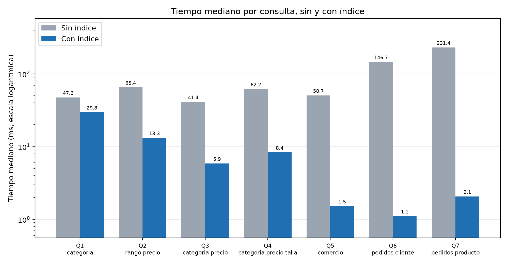
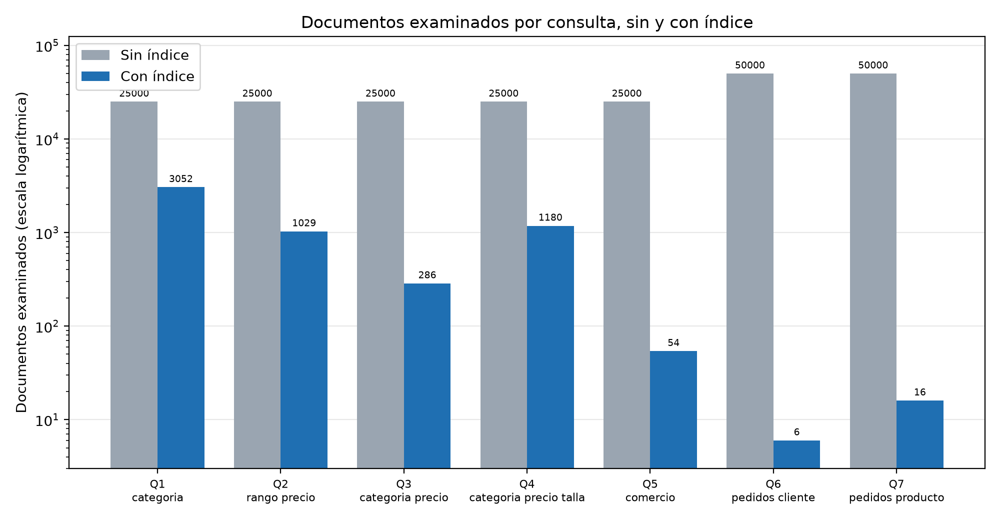
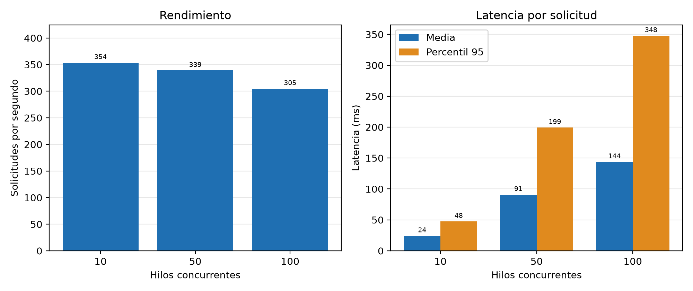
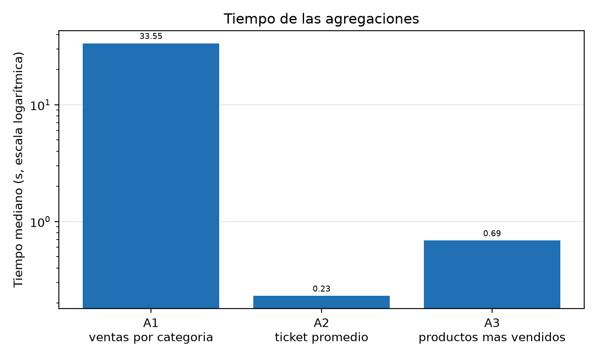

# MercadoTico 360

## Índice

1. [Descripción del proyecto](#1-descripción-del-proyecto)
2. [Problema de negocio](#2-problema-de-negocio)
3. [Objetivos](#3-objetivos)
4. [Tecnologías utilizadas](#4-tecnologías-utilizadas)
5. [Modelo de datos](#5-modelo-de-datos)
6. [Prerrequisitos](#6-prerrequisitos)
7. [Instalación y configuración](#7-instalación-y-configuración)
8. [Generación y carga de datos (seed)](#8-generación-y-carga-de-datos-seed)
9. [Ejecución](#9-ejecución)
10. [Consultas y comandos de demostración](#10-consultas-y-comandos-de-demostración)
11. [Pruebas y resultados](#11-pruebas-y-resultados)
12. [Riesgos y limitaciones](#12-riesgos-y-limitaciones)
13. [Estructura del repositorio](#13-estructura-del-repositorio)
14. [Autores](#14-autores)

## 1. Descripción del proyecto

MercadoTico 360 es una propuesta de almacenamiento NoSQL para un marketplace el cual llegar a abarcar alimentos, ropa, tecnología, artesanías, servicios y otros. Se utilizo MongoDB y documentos BSON para almacenar atributos de los producto, tambien la informacion historica de pedidos. Se trabajo con scripts de python para generar datos de prueba, insertarlos, consultarlos y medir su comportamiento.

## 2. Problema de negocio

MercadoTico 360 maneja productos de distintas categorías, como alimentos, ropa, tecnología, artesanías y servicios. Esta variedad requiere una estructura de datos flexible que permita almacenar diferentes atributos y conservar correctamente el historial de los pedidos.

## 3. Objetivos

### 3.1 Objetivo general

Diseñar e implementar un modelo de base de datos no relacional orientado a documentos utilizando MongoDB Atlas para la plataforma MercadoTico 360.

### 3.2 Objetivos específicos

1. Configurar la arquitectura de almacenamiento en la nube a través de clústeres distribuidos en MongoDB Atlas para asegurar la alta disponibilidad, el aislamiento de consultas y la tolerancia a fallos de la plataforma.

2. Evaluar las limitantes del modelo relacional frente a las ventajas del modelo NoSQL orientado a documentos para entornos transaccionales de alta velocidad y volumen.

3. Estructurar un esquema de datos flexible que consolide en una única colección un catálogo de productos heterogéneo (alimentos, ropa, tecnología, artesanías y servicios) sin incurrir en redundancias ni campos nulos.

4. Desarrollar un patrón de documentos para la colección de pedidos que encapsule las lineas de detalle de las compras, resguardando la integridad historica de los precios y cantidades facturadas.


## 4. Tecnologías utilizadas

| Tecnología | Uso |
|---|---|
| MongoDB / MongoDB Atlas | Base de datos documental y alojamiento en la nube |
| Python | Generación de datos, carga, consultas y pruebas |
| PyMongo (`pymongo`) | Conexión y operaciones con MongoDB |
| `python-dotenv` | Lectura de variables de conexión desde `.env` |
| Faker (`faker`) | Generación de información sintética |
| Matplotlib y NumPy | Elaboración de gráficos de rendimiento |
| `unittest` | Pruebas funcionales (biblioteca estándar de Python) |
| JSON / BSON | Datos de entrada y representación de documentos |
| Git y GitHub | Versionado y publicación del proyecto |


## 5. Modelo de datos

La base de datos esta compuesta por cautro colecciones
- Comercios
- Productos
- Clientes
- Pedidos

### 5.1 Productos

Cada documento incluye identificador, nombre, categoría, precio, comercio, existencias y un subdocumento `atributos` que varía según la categoria.

Ejemplo:

```json
{
"_id": "PROD-00001",
"nombre": "Ejemplo de servicio",
"precio": 154176.85,
"categoria": "Servicios",
"comercio_id": "COM-033",
"stock": 500,
"atributos": {
"requiere_cita": true,
"modalidad": "Presencial"
}
}
```

### 5.2 Clientes

La colección `clientes` almacena la información de los usuarios de la plataforma, incluyendo sus datos de contacto y ubicación.

ALmacena los datos como identificación, nombre, correo, teléfono, cédula y dirección (`provincia`, `canton`, `distrito` y `direccion_exacta`). 

Los datos son sintéticos: las localidades producidas por Faker no necesariamente representan combinaciones geográficas reales de Costa Rica

### 5.3 Pedidos

La coleccion `pedidos` almacena las compras realizadas por los clientes.

Los pedidos incluyen datos como: fecha, cliente, estado, monto total y el arreglo `lineas_detalle` la cual almacena (`producto_id`, `nombre_producto`, `precio_unitario`, `cantidad` y `subtotal`).

### 5.4 Comercios

La colección  `comercios` almacena los negocios asociados al catálogo, el cual tiene datos de contacto, categoría, estado y dirección. `productos.

Tenemos `comercio_id` que identifica el comercio correspondiente.

## 6. Prerrequisitos

Antes de ejecutar el proyecto es necesario contar con:

- Git, para clonar el repositorio
- Python 
- Una cuenta de MongoDB Atlas
- Acceso al cluster de MongoDB Atlas utilizado por el proyecto y conexion a Internet para tener acceso
- Credenciales válidas y permisos de lectura/escritura en la base de datos de trabajo
- PyMongo instalado
- Acceso de red al servidor; en Atlas, configurar el usuario de base de datos y la lista de direcciones IP permitidas
- Espacio suficiente para los archivos JSON y las colecciones de prueba

## 7. Instalación y configuración

### 7.1 Clonar el repositorio

Clonar el repositorio de MercadoTico 360 en el equipo:

```bash

git clone https://github.com/emilio667/MercadoTico-360.git 

```

Ingresar a la carpeta:

```bash

cd MercadoTico-360

```

### 7.2 Crear y activar un entorno virtual (recomendado)

**Windows (PowerShell):**

```powershell
python -m venv .venv
.\.venv\Scripts\Activate.ps1
```

**Linux/macOS:**

```bash
python3 -m venv .venv
source .venv/bin/activate
```

### 7.3 Instalar dependencias

```bash
python -m pip install pymongo python-dotenv faker matplotlib numpy
```

Estas son las dependencias externas observadas en los scripts del repositorio; `unittest`, `json`, `csv` y otras bibliotecas estándar ya vienen con Python.

### 7.4 Configurar MongoDB Atlas

1. Crear o seleccionar un clúster de MongoDB Atlas.
2. Crear un usuario de base de datos con los permisos apropiados.
3. Autorizar la IP desde la que se conectará el equipo, aplicando el acceso más restrictivo posible.
4. Copiar la URI de conexión desde la opción **Connect** de Atlas.
5. Crear un archivo `.env` en la **raíz del repositorio**, a partir de `.env.example`.

**Windows:**

```powershell
Copy-Item .env.example .env
```

**Linux/macOS:**

```bash
cp .env.example .env
```

Editar `.env` con valores propios:

```dotenv
MONGODB_URI=mongodb+srv://USUARIO:CONTRASENA@TU_CLUSTER.mongodb.net/?retryWrites=true&w=majority
MONGODB_DB=MercadoTico360
```


## 8. Carga de datos
La carga de datos utilizara generadores independientes para las principales colecciones del proyecto:

- Productos
- Clientes
- Pedido
- Comercios

### 8.1 La semilla de datos

Los generadores usan `Faker.seed(123)`.

### 8.2 Datos incluidos

| Colección | Documentos en los JSON de `database/seed/` |
|---|---:|
| `comercios` | 500 |
| `clientes` | 10.000 |
| `productos` | 25.000 |
| `pedidos` | 50.000 |
| **Total** | **85.500** |

Los archivos de datos incluidos en el repositorio son:

```text
database/seed/
├── comercios.json
├── clientes.json
├── productos.json
└── pedidos.json
```

### 8.3 Datos sintéticos

Desde la raíz del proyecto, los generadores se encuentran en `database/generadores/`:

```bash
python -m database.generadores.generar_comercios
python -m database.generadores.generar_clientes
python -m database.generadores.generar_productos
python -m database.generadores.generar_pedidos
```

### 8.4 Cargar los datos incluidos

**Advertencia:** la inserción no limpia automáticamente colecciones existentes. Para evitar errores por `_id` duplicados o mezclar corridas, se debe utilizar una base de datos nueva y vacía. No ejecutar esta operación sobre una base de producción.

El script orquestador ejecuta las cargas en el orden comercios, clientes, productos y pedidos:

```bash
python database/seed/seed_data.py
```

Alternativamente, ejecutar cada archivo por separado:

```bash
python database/seed/seed_comercios.py
python database/seed/seed_clientes.py
python database/seed/seed_productos.py
python database/seed/seed_pedidos.py
```

Los scripts leen `MONGODB_URI` y `MONGODB_DB` del `.env`, abren los JSON de `database/seed/` e insertan los documentos mediante PyMongo. En pedidos, convierten el campo `fecha` a un valor `datetime` antes de insertarlo.

### 8.5 Verificar la carga

Usando MongoDB Compass o `mongosh`, conectado a la misma base:

```javascript
use MercadoTico360
db.comercios.countDocuments({})
db.clientes.countDocuments({})
db.productos.countDocuments({})
db.pedidos.countDocuments({})
```

En una base vacía que es cargada una sola vez con los JSON proporcionados, se espera respectivamente tener **500, 10.000, 25.000 y 50.000 documentos**


## 9. Ejecución

- Cargar Seed: `python database/seed/seed_data.py`
- Ejecutar pruebas funcionales: `python test/test_funcionales.py`
- Ejecutar benchmark: `python Performance/scripts/benchmark.py`
- Generar gráficos: `python Performance/scripts/graficos.py`

El proyecto no contiene una aplicación web que deba iniciarse: sus componentes se ejecutan como **scripts de Python** desde la raíz del repositorio, con el entorno virtual activo y el `.env` configurado.


## 10. Consultas y Comandos de demostración

### 10.1 Consultas de productos

[`database/queries/consultas_productos.py`](database/queries/consultas_productos.py). 

La cual permite: 
- Buscar productos por categoría
- Buscar productos por rango de precio
- Buscar productos utilizando atributos específicos
- Combinar filtros de categoría y precio

**Ejemplos reproducibles con `mongosh`:**

```javascript
use MercadoTico360
// Productos de tecnología
db.productos.find({categoria: "Tecnología"}).limit(5)

// Rango de precio
db.productos.find({precio: {$gte: 100000, $lte: 120000}}).limit(5)

// Categoría, precio y talla
db.productos.find({
categoria: "Ropa",
precio: {$gte: 50000, $lte: 250000},
"atributos.talla": "M"
}).limit(5)
```

### 10.2 Consultas de pedidos

[`database/queries/consultas_pedidos.py`](database/queries/consultas_pedidos.py).

La cual permite:
- Recuperar los pedidos de un cliente
- Consultar un pedido con sus líneas de detalle
- Consultar el estado de un pedido
- Actualizar el estado de un pedido

```javascript
// Historial de un cliente ordenado por fecha
db.pedidos.find({cliente_id: "CLI-00001"}).sort({fecha: -1}).limit(5)

// Pedidos que contienen un producto
db.pedidos.find({"lineas_detalle.producto_id": "PROD-00001"}).limit(5)

// Inspeccionar las líneas históricas de un pedido
db.pedidos.findOne({_id: "PED-00001"})
```


### 10.3 Operaciones CRUD

Las funciones de creación, lectura, actualización y eliminación están en [`database/queries/crud.py`](database/queries/crud.py). 

Para demostrar actualizaciones, trabajar sobre una base de pruebas o documentos desechables: no modificar ni eliminar pedidos históricos de la base compartida.

### 10.4 Agregaciones

Las consultas de agregación para obtener información útil para el negocio, como:
- Ventas por categoría.
- Ticket promedio.
- Productos más vendidos.

[`database/queries/agregaciones.py`](database/queries/agregaciones.py).

 Incluye cálculos de ventas por categoría, ticket promedio y productos más vendidos. 
 
 Las consultas analíticas del benchmark se definen también en [`Performance/scripts/benchmark.py`](Performance/scripts/benchmark.py).


### 10.5 Índices y planes de ejecución

Benchmark evalúa los índices:

| Índice | Colección | Campos |
|---|---|---|
| `idx_categoria_precio` | productos | `categoria` asc., `precio` asc. |
| `idx_precio` | productos | `precio` asc. |
| `idx_atributos_talla` | productos | `atributos.talla` asc. |
| `idx_comercio` | productos | `comercio_id` asc. |
| `idx_cliente_fecha` | pedidos | `cliente_id` asc., `fecha` desc. |
| `idx_lineas_producto` | pedidos | `lineas_detalle.producto_id` asc. |

Para inspeccionar una consulta en `mongosh`:

```javascript
db.productos.find({categoria: "Tecnología"}).explain("executionStats")
```

Los archivos JSON de `Performance/resultados_corrida3/capturas/` conservan las salidas `explain` con y sin índice para las siete consultas comparadas.


## 11. Pruebas y resultados

### 11.1 Plan y metodología

El plan está en [`Performance/plan_de_pruebas.md`](Performance/plan_de_pruebas.md). Se contemplan pruebas funcionales, comparaciones de consultas con y sin índices, agregaciones, carga masiva y concurrencia. El benchmark registra medianas, percentil 95 (p95), documentos examinados y planes de ejecución. Los resultados mostrados a continuación proceden de los archivos en `Performance/resultados_corrida3/`.


### 11.2 Pruebas funcionales

Incluyen validación de inserciones, consultas, actualizaciones y operaciones sobre las colecciones.

El script [`test/test_funcionales.py`](test/test_funcionales.py) documenta los casos F01–F10 y las verificaciones V1–V5. 

Las pruebas F usan una base separada con sufijo `_test` y eliminan sus datos de prueba al finalizar. Las comprobaciones V revisan la base cargada, con la salvedad de que V5 intenta insertar y retirar un documento inválido.

```bash
python test/test_funcionales.py
```

El script está diseñado para escribir `Performance/resultados/pruebas_funcionales.csv`. 


### 11.3 Benchmark de rendimiento

Evaluación de los tiempos de respuesta de las consultas y comparación del rendimiento con y sin índices.

**Precaución:** `benchmark.py` elimina y recrea los índices de la lista `INDICES` durante las mediciones. 

Se debe ejecutar únicamente en una base de pruebas dedicada y con autorización del equipo.

```bash
python Performance/scripts/benchmark.py --reps 30 --agg-reps 5
```

Opciones del propio script:

```bash
python Performance/scripts/benchmark.py --skip-concurrency --skip-load
python Performance/scripts/benchmark.py --keep-indexes
```

La ejecución predeterminada se escribe en `Performance/resultados/`.

 Para consultar todas las opciones disponibles:

```bash
python Performance/scripts/benchmark.py --help
```

### 11.4 Comparación de consultas con y sin índices

Los resultados reales de las pruebas, incluyendo evidencias y observaciones.

Resultados de la tercera corrida con tiempos de mediana en milisegundos:

| Consulta | Sin índice (ms) | Con índice (ms) | Mejora de mediana | Docs examinados sin/con |
|---|---:|---:|---:|---:|
| `Q1_categoria` | 47.59 | 29.84 | 37.3 % | 25000 / 3052 |
| `Q2_rango_precio` | 65.43 | 13.26 | 79.7 % | 25000 / 1029 |
| `Q3_categoria_precio` | 41.36 | 5.89 | 85.8 % | 25000 / 286 |
| `Q4_categoria_precio_talla` | 62.16 | 8.36 | 86.5 % | 25000 / 1180 |
| `Q5_comercio` | 50.70 | 1.53 | 97.0 % | 25000 / 54 |
| `Q6_pedidos_cliente` | 146.73 | 1.11 | 99.2 % | 50000 / 6 |
| `Q7_pedidos_producto` | 231.37 | 2.07 | 99.1 % | 50000 / 16 |

En estas siete consultas, el plan registrado pasa de `COLLSCAN` (exploración de colección) a `IXSCAN` (uso de índice), con una reducción de la mediana.

 Esto demuestra mejoras en el entorno y conjunto de datos medidos, no garantiza idénticos porcentajes en otros servidores.






### 11.5 Pruebas de concurrencia

| Hilos | Solicitudes | Solicitudes/s | Latencia media (ms) | p95 (ms) |
|---:|---:|---:|---:|---:|
| 10 | 200 | 353.8 | 24.273 | 47.595 |
| 50 | 1000 | 339.0 | 90.902 | 199.35 |
| 100 | 2000 | 304.8 | 143.815 | 347.905 |

Las pruebas muestran que la latencia aumenta con el número de hilos.




### 11.6 Agregaciones

| Agregación | Resultados devueltos | Repeticiones | Mediana (ms) | p95 (ms) |
|---|---:|---:|---:|---:|
| `A1_ventas_por_categoria` | 8 | 5 | 33550.63 | 38602.80 |
| `A2_ticket_promedio` | 1 | 5 | 230.43 | 294.49 |
| `A3_productos_mas_vendidos` | 10 | 5 | 685.92 | 719.66 |

La agregación de ventas por categoría fue la más costosa de las tres.



### 11.7 Carga masiva

| Colección | Documentos | Tiempo de inserción (s) | Documentos/s |
|---|---:|---:|---:|
| `comercios` | 500 | 0.027 | 18585.8 |
| `clientes` | 10000 | 0.181 | 55142.4 |
| `productos` | 25000 | 0.518 | 48253.0 |
| `pedidos` | 50000 | 2.467 | 20270.8 |


### 11.8 Evidencias y generación de gráficos

Los datos completos de la tercera corrida están en [`Performance/resultados_corrida3/`](Performance/resultados_corrida3/), incluyendo:

- `comparativa_indices.csv`: resumen de tiempos y planes de consulta.
- `consultas_detalle.csv` y `tiempos_crudos.csv`: mediciones detalladas.
- `concurrencia.csv`, `agregaciones.csv` y `carga_masiva.csv`.
- `construccion_indices.csv` y `entorno.json`.
- `capturas/`: planes de ejecución en JSON.
- `graficos/`: imágenes utilizadas.

Para generar gráficos desde la carpeta predeterminada `Performance/resultados/`:

```bash
python Performance/scripts/graficos.py
```

Para graficar específicamente la tercera corrida (usando las opciones del script):

```bash
python Performance/scripts/graficos.py --entrada Performance/resultados_corrida3 --salida Performance/resultados_corrida3/graficos
```

Los resultados de corridas anteriores permanecen en `Performance/resultados/` y `Performance/resultados_corrida2/` para comparación y trazabilidad.


## 12. Riesgos y limitaciones

### 12.1 Riesgos del proyecto
- Conexión a MongoDB Atlas: posibles interrupciones del servicio o problemas de conectividad.
- Seguridad de los datos: riesgo de acceso no autorizado si las credenciales no se protegen adecuadamente.
- Rendimiento: posibles tiempos de respuesta elevados cuando aumente el volumen de información.
- Integridad de los datos: riesgo de inconsistencias si no se validan correctamente los documentos y las operaciones.

### 12.2 Limitaciones del proyecto

- Alcance funcional: el proyecto se enfoca en el diseño e implementación de la base de datos, sin desarrollar una aplicación completa de comercio electrónico.
- Interfaz de usuario: no se contempla el desarrollo de interfaces gráficas para clientes o administradores.
- Procesamiento de pagos: no se incluyen pasarelas de pago ni transacciones financieras reales.
Logística: no se implementan procesos de envio o distribución de productos.
- Dependencia de MongoDB Atlas: el acceso a la base de datos requiere conectividad y disponibilidad del servicio en la nube.

## 13. Estructura del repositorio

```text

MercadoTico-360/

├── data/

│   └── README.md

│

├── database/

│   ├── Index/

│   ├── integrante3/

│   ├── queires/

│   └── schemas/

│

├── docs/

├── Performance/

├── test/

├── Entregables/

├── Paper técnico/

│

├── DATA_ARCHITECTURE.md

├── LICENSE

└── README.md

```

### Descripción de las carpetas principales

- `data/`: generación y carga de los datos utilizados por el proyecto.

- `database/`: archivos relacionados con la implementación de la base de datos.

- `database/Index/`: definición de índices para optimizar las consultas.

- `database/integrante3/`: scripts actuales de conexión y pruebas con MongoDB Atlas.

- `database/queires/`: consultas y agregaciones del proyecto.

- `database/schemas/`: definición de las estructuras de datos.

- `docs/`: documentación sobre arquitectura, modelo de datos y decisiones de diseño.

- `Performance/`: evidencia de las pruebas de rendimiento de los índices.

- `test/`: pruebas del proyecto.

- `Entregables/`: documentos correspondientes a las entregas del proyecto.

- `Paper técnico/`: archivos relacionados con el paper técnico.


## 14. Autores

- Adrián Quesada Jiménez
- Camila Alpízar Alfaro
- Emilio Calderón Jiménez
- Gustavo Jiménez Hidalgo
- Justin Zhu Fan
- Salma Capín Romero